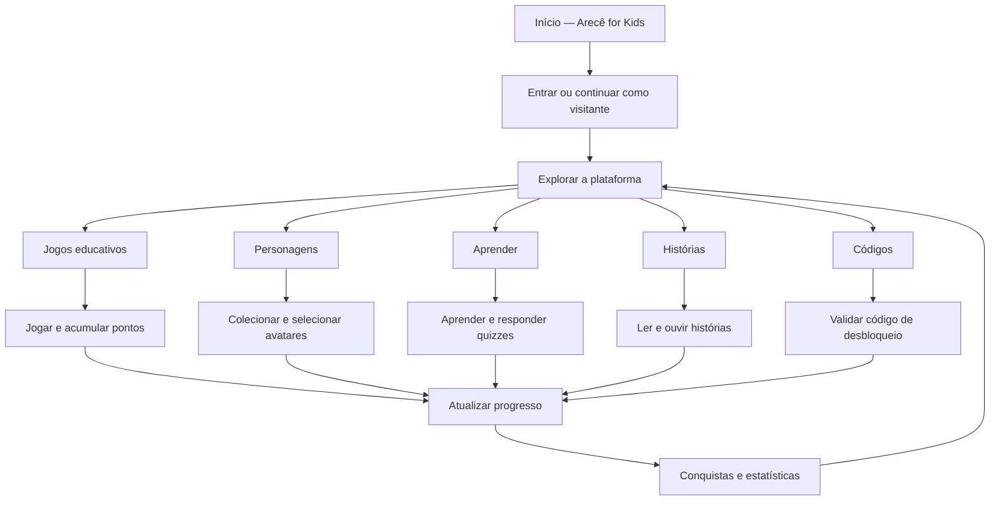
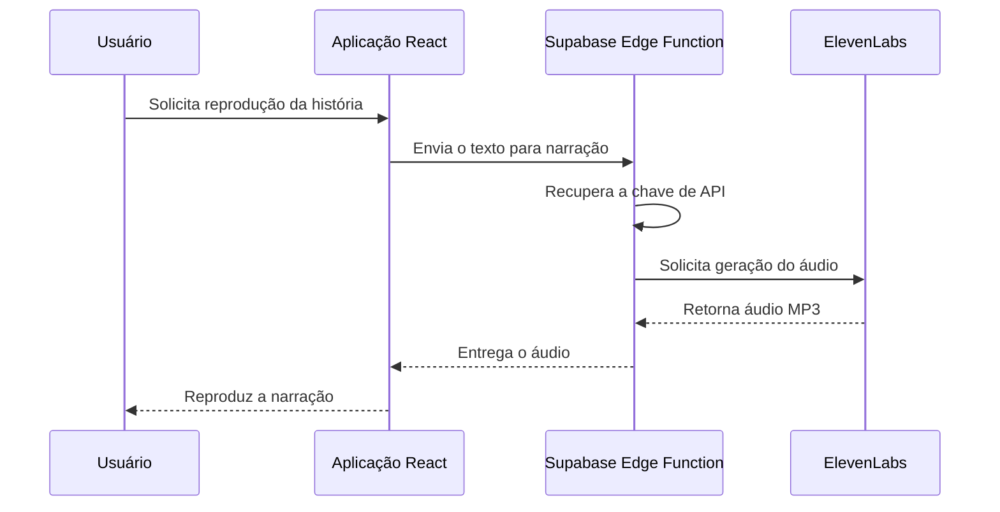

# 🌿 Arecê for Kids — Jogo Educativo

<p align="center">
  <strong>Onde a diversão encontra a natureza!</strong>
</p>

<p align="center">
  Uma plataforma interativa que transforma educação ambiental e prevenção ao Aedes aegypti em uma aventura gamificada para crianças.
</p>

---

## 📖 Sobre o projeto

**Arecê for Kids** é uma aplicação web educativa desenvolvida para aproximar o público infantil de temas como saúde, prevenção de doenças transmitidas por mosquitos, preservação ambiental e biodiversidade amazônica.

A plataforma combina jogos, personagens colecionáveis, histórias interativas, conteúdos educativos e conquistas para tornar o aprendizado mais envolvente.

O projeto também integra a identidade da marca **Arecê**, que pretende desenvolver uma linha de produtos cosméticos com propriedades repelentes inspiradas em ingredientes naturais da Amazônia, incluindo uma proposta voltada ao público infantil.

A experiência foi concebida para incentivar as crianças a aprenderem enquanto exploram um universo lúdico, acumulam pontos, desbloqueiam personagens e avançam em diferentes desafios.

### 🎯 Objetivos

- **Educação ambiental:** apresentar conceitos de sustentabilidade, biodiversidade e preservação da natureza.
- **Prevenção:** ensinar hábitos que ajudam a evitar a proliferação do *Aedes aegypti* e reduzir a exposição a picadas.
- **Aprendizado gamificado:** transformar conteúdos educativos em desafios e atividades interativas.
- **Engajamento:** estimular a continuidade da experiência por meio de pontos, conquistas e colecionáveis.
- **Identidade de marca:** integrar a proposta educativa ao universo visual e narrativo da Arecê.

---

## 🎮 Funcionalidades

### 1. Jogos educativos

A plataforma disponibiliza cinco modalidades de jogos, cada uma com cinco níveis configurados:

| Jogo | Descrição |
|---|---|
| 🧠 Jogo da Memória | Encontre pares e exercite a memória. |
| ❓ Quiz do Saber | Responda perguntas sobre saúde, mosquitos e natureza. |
| 🔍 Caça-Palavras | Encontre palavras relacionadas aos temas educativos. |
| ✏️ Palavras Cruzadas | Resolva desafios utilizando dicas e conhecimentos adquiridos. |
| 🦟 Caça aos Mosquitos | Participe de uma atividade interativa de combate aos mosquitos. |

Os desafios possuem conteúdos organizados por níveis, com conjuntos de perguntas, palavras e pistas que permitem trabalhar diferentes graus de conhecimento.

**Desbloqueio:** o Jogo da Memória está disponível inicialmente. Os demais jogos podem ser desbloqueados por meio de códigos.

### 2. Personagens colecionáveis

A aplicação possui oito personagens, organizados em quatro categorias de raridade:

| Raridade | Personagens |
|---|---|
| ⭐ Básico | Gotinha e Folhinha |
| 🌳 Comum | Copi e Naturinha |
| 💜 Épico | Guardião Verde e Curandeira |
| 👑 Lendário | Arecê e Espírito da Amazônia |

Cada personagem possui:

- Nome e descrição.
- História própria.
- Habilidade especial.
- Categoria de raridade.
- Código de desbloqueio.
- Representação visual por emoji.

Os personagens podem ser visualizados individualmente em cartões detalhados. Aqueles que já foram desbloqueados também podem ser selecionados como avatar do jogador.

### 3. Sistema de códigos de desbloqueio

A plataforma possui uma área específica para inserir códigos promocionais.

O sistema verifica os códigos e permite desbloquear:

- Novos jogos.
- Novos personagens.
- Itens colecionáveis associados à experiência da marca.

O primeiro jogo e o primeiro personagem são disponibilizados gratuitamente. Os demais conteúdos possuem códigos definidos na configuração do projeto.

> **Observação técnica:** na implementação atual, os códigos estão definidos no frontend e a validação acontece localmente. Portanto, o mecanismo funciona como desbloqueio demonstrativo, mas ainda não oferece validação segura de compras, códigos individuais de uso único ou proteção contra compartilhamento e reutilização. Para uso comercial, recomenda-se migrar essa validação para uma função de backend com códigos individuais armazenados e controlados no banco de dados.

### 4. Área de aprendizagem

A seção **Aprender** apresenta oito módulos educativos:

| Tema | Conteúdo |
|---|---|
| 🦟 Como Combater o Aedes aegypti | Identificação e eliminação de possíveis criadouros. |
| 🛡️ Como Evitar Picadas de Mosquito | Hábitos de proteção e prevenção. |
| 🏥 Doenças Transmitidas pelo Aedes | Informações sobre dengue, zika, chikungunya e outras doenças. |
| 🌳 Como Preservar a Natureza | Práticas de conservação ambiental. |
| 🌿 Como a Natureza nos Ajuda | Benefícios dos ecossistemas e da biodiversidade. |
| ⚠️ Impactos da Destruição da Natureza | Consequências ambientais do desmatamento e da poluição. |
| 🌴 A Floresta Amazônica | Biodiversidade e importância da Amazônia. |
| ♻️ Hábitos Sustentáveis | Atitudes cotidianas para um estilo de vida mais sustentável. |

Cada módulo apresenta informações organizadas em tópicos e uma atividade de perguntas e respostas.

As respostas corretas concedem pontos ao jogador e a conclusão de determinados conteúdos contribui para o sistema de conquistas.

### 5. Histórias interativas com narração

A plataforma apresenta histórias educativas divididas em páginas, com navegação entre os trechos e controles de áudio.

A experiência inclui:

- Leitura de histórias ilustradas por elementos visuais.
- Navegação entre páginas.
- Reprodução e pausa da narração.
- Controle de áudio.
- Acompanhamento de histórias concluídas.

A geração de áudio é integrada à **ElevenLabs**, utilizando uma função serverless do Supabase.

### 6. Sistema de conquistas

O jogador pode desbloquear medalhas ao cumprir objetivos relacionados à sua participação na plataforma.

As conquistas estão distribuídas em cinco categorias:

- 🎮 Jogos.
- 🧸 Coleção.
- 📚 Aprendizado.
- 📖 Histórias.
- ✨ Especiais.

Entre os objetivos existentes estão completar jogos, alcançar pontuações, desbloquear personagens, ler conteúdos educativos, concluir histórias e manter uma sequência de dias jogados.

A aplicação possui **15 conquistas configuradas**, com indicadores de progresso e identificação visual das conquistas desbloqueadas.

### 7. Perfil e acompanhamento do jogador

Cada jogador possui informações de progresso, incluindo:

- Apelido.
- Avatar selecionado.
- Jogos desbloqueados.
- Personagens desbloqueados.
- Conquistas obtidas.
- Pontuação total.
- Moedas.
- Histórico de desempenho por jogo e nível.

O jogador também pode consultar suas estatísticas e personalizar seu perfil.

---

## 🧭 Fluxo de funcionamento



---

## 🛠️ Tecnologias utilizadas

O projeto utiliza uma arquitetura frontend baseada em React, com integração a serviços do Supabase para autenticação, persistência e processamento de áudio.

### Frontend

| Tecnologia | Utilização |
|---|---|
| React 18 | Construção da interface e componentes. |
| TypeScript | Tipagem estática e organização do código. |
| Vite | Desenvolvimento e build da aplicação. |
| React Router DOM | Navegação entre páginas. |
| Tailwind CSS | Estilização e responsividade. |
| shadcn/ui | Componentes reutilizáveis de interface. |
| Radix UI | Componentes acessíveis e primitivos de interface. |
| Lucide React | Ícones. |
| TanStack React Query | Gerenciamento de consultas e estado assíncrono. |
| Recharts | Biblioteca de visualização de dados disponível no projeto. |

### Backend e serviços

| Tecnologia | Utilização |
|---|---|
| Supabase Auth | Autenticação dos usuários. |
| Supabase Database | Armazenamento do progresso dos jogadores. |
| PostgreSQL | Banco de dados relacional. |
| Row Level Security (RLS) | Controle de acesso aos registros. |
| Supabase Edge Functions | Execução de funções no servidor. |
| Deno | Ambiente de execução da função serverless. |
| ElevenLabs API | Geração de narração em áudio. |

### Ferramentas de desenvolvimento

- Node.js.
- npm.
- ESLint.
- TypeScript.
- Lovable.
- Git e GitHub.

---

## 🏗️ Arquitetura e organização do projeto

A aplicação foi organizada em componentes reutilizáveis, páginas, contextos de estado, dados estáticos e integrações externas.

```text
arece-for-kids/
│
├── public/
│   ├── favicon.ico
│   ├── placeholder.svg
│   └── robots.txt
│
├── src/
│   │
│   ├── components/
│   │   ├── games/
│   │   │   ├── CrosswordGame.tsx
│   │   │   ├── MemoryGame.tsx
│   │   │   ├── MosquitoGame.tsx
│   │   │   ├── QuizGame.tsx
│   │   │   └── WordSearchGame.tsx
│   │   │
│   │   ├── ui/
│   │   ├── CharacterCard.tsx
│   │   ├── CharacterModal.tsx
│   │   ├── GameCard.tsx
│   │   ├── Header.tsx
│   │   └── NavLink.tsx
│   │
│   ├── contexts/
│   │   ├── AuthContext.tsx
│   │   └── GameContext.tsx
│   │
│   ├── data/
│   │   └── gameData.ts
│   │
│   ├── hooks/
│   ├── integrations/
│   │   └── supabase/
│   │       ├── client.ts
│   │       └── types.ts
│   │
│   ├── lib/
│   │   └── utils.ts
│   │
│   ├── pages/
│   │   ├── AchievementsPage.tsx
│   │   ├── AuthPage.tsx
│   │   ├── CharactersPage.tsx
│   │   ├── GamePlayPage.tsx
│   │   ├── GamesPage.tsx
│   │   ├── Index.tsx
│   │   ├── LearnPage.tsx
│   │   ├── RedeemPage.tsx
│   │   ├── SettingsPage.tsx
│   │   ├── StoriesPage.tsx
│   │   └── NotFound.tsx
│   │
│   ├── types/
│   │   └── game.ts
│   │
│   ├── App.tsx
│   ├── App.css
│   ├── index.css
│   └── main.tsx
│
├── supabase/
│   ├── functions/
│   │   └── text-to-speech/
│   │       └── index.ts
│   │
│   ├── migrations/
│   └── config.toml
│
├── index.html
├── package.json
├── package-lock.json
├── tailwind.config.ts
├── tsconfig.json
├── vite.config.ts
└── README.md
```

### Responsabilidade dos principais módulos

| Arquivo | Responsabilidade |
|---|---|
| `App.tsx` | Configuração dos provedores e rotas da aplicação. |
| `AuthContext.tsx` | Gerenciamento da autenticação e sessão do usuário. |
| `GameContext.tsx` | Gerenciamento do progresso, desbloqueios, pontos e conquistas. |
| `gameData.ts` | Definição dos jogos, personagens, códigos, conquistas e conteúdos educativos. |
| `GamePlayPage.tsx` | Organização da experiência de execução dos jogos. |
| `LearnPage.tsx` | Exibição dos módulos educativos e quizzes. |
| `StoriesPage.tsx` | Experiência de leitura e narração das histórias. |
| `RedeemPage.tsx` | Interface para inserção de códigos. |
| `AchievementsPage.tsx` | Exibição das conquistas e respectivos progressos. |
| `supabase/functions/text-to-speech/index.ts` | Integração serverless com a ElevenLabs. |

---

## 💾 Persistência e gerenciamento de dados

O progresso dos jogadores é administrado pelo `GameContext`, que centraliza as operações relacionadas à experiência de jogo.

### Usuários visitantes

Quando o jogador utiliza a plataforma sem autenticação, o progresso é armazenado no `localStorage` do navegador.

As principais chaves utilizadas são:

```text
arece_player_state
arece_achievement_progress
```

### Usuários autenticados

Quando existe uma sessão autenticada, a aplicação utiliza o Supabase para consultar e sincronizar o progresso do jogador.

A tabela principal é:

```text
public.user_progress
```

Ela armazena informações como:

- `user_id`
- `nickname`
- `selected_character`
- `unlocked_characters`
- `unlocked_games`
- `achievements`
- `achievement_progress`
- `game_progress`
- `coins`
- `total_points`
- `created_at`
- `updated_at`

A migração SQL também configura políticas de Row Level Security para restringir o acesso aos registros associados ao usuário autenticado.

A sincronização de alterações para o banco de dados é realizada com um pequeno atraso, evitando múltiplas gravações imediatas durante atualizações sucessivas do estado.

---

## 🔊 Integração com ElevenLabs

A funcionalidade de narração utiliza uma Supabase Edge Function chamada `text-to-speech`.

O fluxo é:



A função utiliza:

- Modelo `eleven_multilingual_v2`.
- Saída MP3.
- Configurações de voz ajustadas para uma narração mais lenta.
- Uma voz configurada para o conteúdo em português.

A chave da ElevenLabs deve permanecer exclusivamente no ambiente da função serverless.

---

## 🎨 Identidade visual

A interface utiliza a identidade visual da marca Arecê, adaptada para uma experiência infantil, colorida e interativa.

| Elemento | Especificação |
|---|---|
| Cor primária | `#f9f7f0` |
| Cor secundária | `#aa4328` |
| Cor de destaque | `#e78345` |
| Fonte principal | TAN Pearl |
| Fonte secundária | Montserrat |

O projeto também utiliza gradientes, cartões, animações, elementos ilustrativos e ícones para criar uma experiência visual mais envolvente.

---

## 🚀 Como executar localmente

### 1. Pré-requisitos

Antes de começar, instale:

- [Node.js](https://nodejs.org/)
- [npm](https://www.npmjs.com/)
- [Git](https://git-scm.com/)

Também será necessário configurar um projeto no [Supabase](https://supabase.com/) para utilizar autenticação, persistência remota e narração.

### 2. Clone o repositório

```bash
git clone https://github.com/Gloterianota349/arece-for-kids.git
```

Entre no diretório:

```bash
cd arece-for-kids
```

### 3. Instale as dependências

```bash
npm install
```

### 4. Configure as variáveis de ambiente

Crie um arquivo `.env` na raiz do projeto:

```env
VITE_SUPABASE_URL=https://SEU-PROJETO.supabase.co
VITE_SUPABASE_PUBLISHABLE_KEY=SUA_CHAVE_PUBLICAVEL
```

Substitua os valores pelas informações do seu projeto Supabase.

> Utilize somente a chave publicável apropriada para o frontend. Nunca coloque `service_role`, senhas ou outras credenciais privadas em variáveis com prefixo `VITE_`.

### 5. Configure o banco de dados

Aplique as migrações disponíveis em `supabase/migrations/` ao projeto Supabase.

Elas incluem a criação da tabela `user_progress`, as políticas de acesso e os mecanismos auxiliares de atualização dos registros.

### 6. Configure a narração

Configure a chave da ElevenLabs como segredo do Supabase:

```bash
npx supabase secrets set ELEVENLABS_API_KEY=SUA_CHAVE_PRIVADA
```

Faça o deploy da função:

```bash
npx supabase functions deploy text-to-speech
```

A chave privada deve ser configurada somente no ambiente do Supabase, nunca no código frontend.

### 7. Inicie a aplicação

```bash
npm run dev
```

O Vite disponibilizará o endereço local no terminal, normalmente:

```text
http://localhost:5173
```

---

## 📦 Scripts disponíveis

Os comandos definidos em `package.json` são:

| Comando | Descrição |
|---|---|
| `npm run dev` | Inicia o servidor de desenvolvimento. |
| `npm run build` | Gera a versão de produção. |
| `npm run build:dev` | Gera uma build utilizando o modo development. |
| `npm run preview` | Executa uma pré-visualização da build. |
| `npm run lint` | Executa a análise estática com ESLint. |

Para gerar a versão de produção:

```bash
npm run build
```

---

## 🗺️ Possíveis evoluções

Algumas melhorias que podem ampliar o potencial da plataforma:

- [ ] Implementar um sistema de códigos únicos vinculados às compras.
- [ ] Criar um painel administrativo para gerenciar códigos, campanhas e usuários.
- [ ] Desenvolver um sistema de recompensas e itens colecionáveis adicionais.
- [ ] Ampliar o catálogo de jogos e personagens.
- [ ] Criar rankings e desafios entre jogadores.
- [ ] Implementar relatórios de evolução e aprendizagem.
- [ ] Melhorar a acessibilidade para diferentes faixas etárias.
- [ ] Implementar controles parentais e mecanismos adicionais de proteção infantil.
- [ ] Revisar e validar cientificamente os conteúdos educativos.
- [ ] Aprimorar o sistema de sincronização e recuperação de progresso.

---

## 👨‍💻 Autor

**Guilherme Andrade**

- GitHub: [@Gloterianota349](https://github.com/Gloterianota349)
- LinkedIn: [guilherme-andrade-developer](https://www.linkedin.com/in/guilherme-andrade-developer/)

---

<p align="center">
  🌿 <strong>Arecê for Kids</strong>
  <br />
  <em>Pequenas aventuras. Grandes descobertas. Um futuro mais sustentável.</em>
</p>
